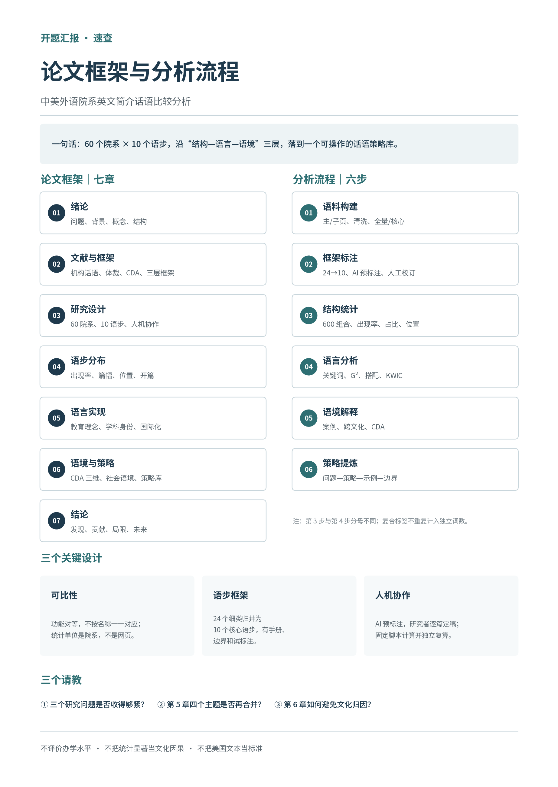

# 开题汇报：论文框架与分析流程

本文件夹为《基于语料库技术的中美外语院系英文简介话语比较分析》的开题汇报准备材料。重点不是阶段性结果，而是论文的章节框架和分析流程，主线是：

> **语步结构 → 语言实现 → 语境解释 → 话语策略**

## 文件

| 文件 | 用途 |
|---|---|
| [开题汇报_论文框架与分析流程.docx](开题汇报_论文框架与分析流程.docx) | 主文档：三个研究问题、七章框架、六步流程、三个关键设计、8分钟口述提纲、八个追问、汇报前检查 |
| [开题汇报_一页速查.png](开题汇报_一页速查.png) | A4 一页速查，可打印或放在手边 |
| [figures/analysis_flow.png](figures/analysis_flow.png) | 分析流程图，可单独投影或插入 PPT |
| [figures/analysis_flow.svg](figures/analysis_flow.svg) | 流程图的矢量版，便于放大或改色 |
| [开题汇报_论文框架与分析流程.md](开题汇报_论文框架与分析流程.md) | 文字版，便于在线查看和修改 |
| [scripts/](scripts/) | 生成图表和文档的脚本；字体路径依赖临时环境，仅作留档 |

## 建议使用顺序

1. 先看一页速查，确定明天开口的五句话。
2. 再用主文档第五节的 8 分钟口述提纲，按时间试讲一遍。
3. 老师追问时翻到第六节，按“判断—依据—边界”回答。
4. 最后用第七节检查是否带齐材料。

## 口径说明

- 语料：中美各 30 个院系级文本，共 639,455 个有效词。
- 标注：35,083 个标注单元，其中 30,084 个有效语步单元。
- 分析单位：院系，不是网页；主要比较使用核心可比文本。
- 统计：语步使用出现率、单篇占比和中位数；关键词使用每万词标准化频次、G²、log2 和 BH 校正。
- AI 只承担预标注、文本整理和脚本辅助，最终标签为人工逐篇校订。

## 注意

本文件夹不包含原始语料和逐篇标注文本。引用具体数字时，以主文档和中期报告中的表 2-2 至表 2-8 为准。
