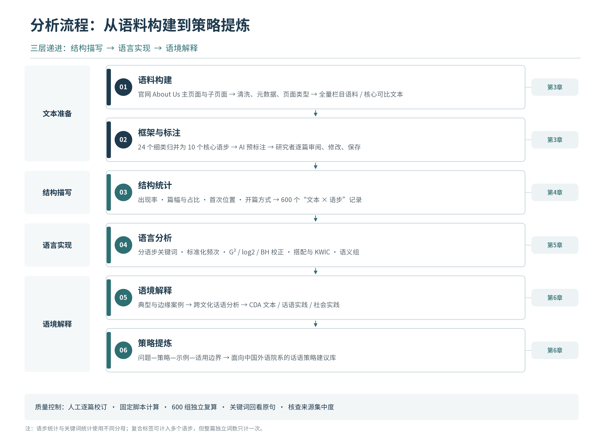

> 开题汇报材料

# 基于语料库技术的中美外语院系英文简介话语比较分析

**论文框架与分析流程**

2026年10月　·　汇报人：\_\_\_\_\_\_\_\_\_\_\_\_

> **一句话**　这篇论文不满足于列出中美差异，而是要说明差异出现在文本的哪个层次、如何被语言实现、又能怎样转化为写作策略。

# 一 研究定位：先说明这篇论文不做什么

这项研究以中美高校外语院系的英文 About Us 文本为对象，考察两类院系如何组织信息、呈现教育理念与学科身份，并把文本中的选择放回高等教育国际化与机构传播的语境中解释。论文不评价哪一国、哪一所院系的办学水平，也不把美国文本当作写作标准。

分析单位是院系，不是网页；进入主要比较的是承担单位整体介绍功能的“核心可比文本”，不是网站上的全部栏目。中美院系的网站结构、页面数量和文本长度差异都很大，如果把所有页面混在一起比较，容易把网站结构差异误当成话语差异。

## （一）三个递进的研究问题

**RQ1 结构** 中美外语院系英文简介由哪些语步构成？各语步在出现率、篇幅占比和文本位置上呈现怎样的共性与差异？

**RQ2 语言** 在核心语步中，两国院系通过哪些关键词、搭配和典型语句，建构教育理念、学科身份与国际化形象？

**RQ3 语境解释** 这些话语选择与哪些高等教育制度、机构定位和跨文化传播语境相关？

三个问题对应三个分析层次，不是三套并列的方法。RQ1 解决“写了什么、写多少、放在哪里”；RQ2 解决“怎样写”；RQ3 解决“为什么这样写”。策略建议库不是第四个研究问题，而是第6章在解释之后完成的实践转化。

## （二）五个研究内容，收成三个问题

申报书列出五个研究内容：语步模式、教育理念、学科身份、国际化、多语种与跨学科。这是五个分析维度，不是五篇并列的小论文。如果论文按五个维度平均用力，容易出现“每部分都有一点、但主线不清”的问题。因此，论文把它们收在三个递进问题下面：第4章回答结构问题，第5章用四个主题回答语言问题，第6章回答语境解释问题，并在解释之后完成策略转化。

表1　三个研究问题与申报书五个维度的对应关系

| **论文问题** | **申报书对应维度** | **主要分析材料** | **章节** |
|:--:|:---|:---|:--:|
| **RQ1 结构** | 维度一：体裁构成与语步模式（RQ1） | 600个“文本 × 语步”记录；出现率、篇幅、位置 | 第4章 |
| **RQ2 语言** | 维度二：教育理念（RQ2）；维度三：学科身份（RQ3）；维度四：国际化（RQ4）；维度五：多语种与跨学科（RQ5） | M03/M04/M05/M08 的关键词、搭配、KWIC 与典型句 | 第5章 |
| **RQ3 语境解释** | RQ2—RQ5 的语境解释 | 8—10个典型/边缘案例；CDA 三维；制度与学科语境 | 第6章 |

第6章在解释之后提炼话语策略建议库，作为论文的实践转化；它服务于研究目的，但不单列为研究问题。

# 二 论文框架：七章，一条主线

论文分七章。第1—3章搭架子：提出问题、建立分析坐标、说明数据和方法；第4—6章是主体，分别回答三个问题；第7章收束。主线可以压缩成三句话：第4章看差异在哪里，第5章看差异如何被说出，第6章看差异为什么形成、如何转化。

表2　论文七章框架

| **章节** | **核心任务** | **主要内容** | **回答的问题** |
|:--:|:---|:---|:--:|
| **第1章 绪论** | 提出问题、划定边界 | 研究背景；研究问题；研究意义；核心概念；论文结构 | 为什么研究、研究什么 |
| **第2章 文献综述与理论框架** | 建立分析坐标 | 高校机构简介与自我呈现；体裁分析与语步（Swales/Bhatia）；语料库辅助话语分析；批评话语分析；跨文化话语分析；三层框架 | 已有研究做到哪、本文从哪里进入 |
| **第3章 研究设计** | 说明数据与方法 | 60个院系；全量栏目语料与核心可比文本；10个核心语步；AI 预标注与人工校订；统计与质性方法；质量控制 | 用什么材料、怎样保证可信 |
| **第4章 语步分布** | 回答 RQ1 | 语步总体覆盖；出现率；篇幅与占比；首次位置与开篇方式 | 差异在哪里 |
| **第5章 语言实现** | 回答 RQ2 | 教育理念与培养目标；学科身份与自我呈现；国际化表述；多语种与跨学科；关键词、搭配、典型句 | 差异如何被说出 |
| **第6章 语境解释与策略** | 回答 RQ3 | 跨文化话语分析；CDA 文本—话语实践—社会实践；社会文化语境；话语策略建议库；解释边界 | 差异为何形成、如何转化 |
| **第7章 结论** | 收束全文 | 主要发现；理论贡献与实践启示；研究局限；未来研究 | 这篇论文说明了什么 |

第4章和第5章是“描写”，第6章是“解释”。三章不能平均用力：第4章先把整体结构说清楚，第5章选准几个最能说明问题的核心语步，第6章再回到典型案例和语境。否则论文容易变成“统计结果加几句文化解释”。

## （一）第5章：四个主题，回答“怎样写”

第5章不按语步代码逐一介绍，而是按四个研究主题组织。每个主题先看该语步在中美文本中的关键词和搭配，再回到典型语句，最后归纳身份或理念的表达方式。

表3　第5章四个分析主题

| **章节** | **分析主题** | **分析重点** |
|:--:|:---|:---|
| **5.1** | 教育理念与培养目标 | M03 使命愿景 + M05 课程培养；工具性与人文性的张力；能力表述 |
| **5.2** | 学科身份与学术自我呈现 | M04 学科价值与研究取向；自我指称、评价修饰语、名词化 |
| **5.3** | 国际化表述 | M08 合作网络与社会服务；理想主义、工具主义、教育主义三种策略 |
| **5.4** | 多语种资源与跨学科整合 | M04/M05/M08 跨语步主题；语种供给、区域国别、跨学科路径、社会服务 |

## （二）第6章：从文本到语境，再到策略

第6章不做泛泛的文化对比，而是沿着 Fairclough 的 CDA 三维框架走：先看文本内部的及物性、情态和人称，再看文本如何引用政策、排名、校友等资源来设计受众，最后把文本放回高等教育国际化、机构定位和学科传统中解释。解释之后，才提炼策略。

表4　第6章的内部安排

| **小节** | **任务** | **具体内容** |
|:--:|:---|:---|
| **6.1** | 从统计差异到解释问题 | 按语步完整度、篇幅和机构类型分层，选取典型与边缘案例 |
| **6.2** | 文本维度 | 及物性、情态、人称、评价资源 |
| **6.3** | 话语实践 | 互文性、受众设计、文本生产与消费 |
| **6.4** | 社会实践 | 高等教育国际化、机构定位、学科传统、评价与资源 |
| **6.5** | 话语策略建议库 | 问题—策略—示例—适用边界 |
| **6.6** | 解释边界 | 区分样本差异、语境关联与因果断言 |

# 三 分析流程：六步，三层

分析流程不是从“找关键词”开始，而是从“确定什么算一篇可比较的文本”开始。整个过程分六步：前三步解决“拿什么比、怎样标、结构如何”，第四步解决“语言如何实现”，第五、六步解决“如何解释、如何转化”。

图1　分析流程：从语料构建到策略提炼

表5　分析流程六步

| **步骤** | **关键操作** | **主要产出** | **章节** |
|:--:|:---|:---|:--:|
| **1 语料构建** | 以 About Us 主页面及子页面为入口；清洗导航、页脚、版权声明；记录国家、学校、院系、页面类型、URL、采集时间；区分全量栏目语料与核心可比文本 | 60个院系级文本，中美各30；两个子库 | 第3章 |
| **2 框架与标注** | 24个细类按交际目的归并为10个核心语步；先试标注；AI 预标注；研究者逐篇审阅、修改、保存；复合标签保留 | 35,083个标注单元；30,084个有效语步单元；编码手册 | 第3章 |
| **3 结构统计** | 每篇文本 × 每个语步建立记录；计算出现率、语步词数中位数与四分位距、单篇占比、首次位置、开篇比例 | 600条记录；表2-2至2-4；图2-1至2-3 | 第4章 |
| **4 语言分析** | 分语步建立子库；每万词标准化频次；G²、log2、BH 校正；搭配与 KWIC；语义组与典型句 | 关键词表；语义组；典型语句库 | 第5章 |
| **5 语境解释** | 选典型与边缘案例；跨文化话语分析；CDA 文本—话语实践—社会实践；结合制度、学科与传播语境 | 解释性发现；案例链 | 第6章 |
| **6 策略提炼** | 把发现整理成“问题—策略—示例—适用边界”；区分可直接借鉴与需本土化调整 | 话语策略建议库 | 第6章 |

> **带三样东西**　一页流程图、七章框架表、三个请教的问题。
>
> **开口三句话**　今天汇报整体设计；主线是结构—语言—语境—策略；请老师重点指正三处。
>
> **四个不要**　不逐条念文献；不把统计显著说成文化因果；不把美国文本当标准；不把 AI 说成自动得出结论。
>
> **最后一句**　目前60个文本已完成标注和试分析，流程可复算；下一步做第6章和策略库。

目前语料与标注已经完成：60个院系级文本，共639,455个有效词；35,083个标注单元，其中30,084个有效语步单元，其余4,999个为 OTHER（导航、页脚等非命题残片）。第4章的语步分布和第5章的关键词分析已有试分析，600个“文本 × 语步”组合可以从标注单元独立复算。下一步的重点是第5章的三种国际化策略编码、第6章的 CDA 个案分析、策略库和全文整合。

# 四 三个关键设计，决定论文能不能站住

下面三点，是老师最可能追问、也最需要提前想清楚的地方。

## （一）可比性：按功能对等，不按名称对等

中国有外国语学院、英语学院、外语系等名称；美国有 Department of Modern Languages、Department of World Languages、Program in International Studies 等设置。论文不以名称一一对应为前提，而以“是否实际承担外语、语言、文学或区域研究的教学与研究职能”为筛选标准。美国样本中的 international studies 只是抽样口径，报告中统一称“外语院系”。统计单位是院系，不是页面；主要比较使用核心可比文本，全量栏目语料只用于检索和补充。

## （二）语步框架：24→10，不是先验套用

10个核心语步参照 Yu（2023）的跨文化体裁分析，并结合试标注，从24个细类归并而来；24类全部有归属，归并依据是交际目的和体裁功能，不是按国别或篇幅合并。编码手册为每个语步给出定义、子语阶、边界规则和正反例；正式标注前先做试标注，遇到边界不清的句子立即回到手册修改。这样做的目的，是让“语步”成为可操作、可复核的分析单位，而不是读完文本后的印象。

## （三）人机协作与统计口径：AI 预标注，人工定稿；长度不均衡，看率、看占比

AI 承担预标注、文本整理和脚本编写；最终标签由研究者逐篇审阅、修改、保存。后续统计只使用人工校订后的标签，不使用 AI 原始输出。关键词统计使用固定脚本，计算每万词频次、G²、log2 比率和 BH 校正；重要词项回到 KWIC 和原句核查，避免只看词表下结论。

两国文本长度差异很大：中国子库78,781个有效词，美国子库560,674个有效词；单篇中位长度约1,451词和10,278词。直接比较原始词频，会把文本长度差异当成话语差异。因此，语步比较以出现率、单篇占比和中位数为主；关键词比较使用每万词标准化频次。

第6章要守住一条线：统计差异只能说明样本中的话语选择不同，不能直接证明文化因果。解释时结合效应量、词项来源是否集中于少数院系、原句语境和制度背景；结论限定在本研究的60个文本，不写成对中美外语教育的总体判断。

# 五 明天怎么讲：8分钟口述提纲

如果老师给10分钟左右，可以按下面的顺序讲。不要逐条念表格；重点讲清楚三问、七章、六步和三个关键设计。

表6　8—9分钟汇报的时间分配

|   **时间**    | **内容**           | **目的**                   |
|:-------------:|:-------------------|:---------------------------|
| **0:00—1:00** | 研究定位与三个问题 | 让老师知道论文要回答什么   |
| **1:00—3:00** | 七章框架           | 说明全文怎样组织           |
| **3:00—6:00** | 六步流程           | 说明数据怎样一步步分析     |
| **6:00—8:00** | 三个关键设计       | 说明可比性、语步、人机协作 |
| **8:00—9:00** | 进度与三个请教     | 说明可行性与需要指正的地方 |

## （一）可直接照着讲

**【0:00—1:00】　**老师好，我汇报的是论文的整体设计和分析流程。今天重点不是汇报已经得到哪些差异，而是说明这篇论文准备怎样一步步回答研究问题。

**【0:00—1:00】　**我的研究定位可以概括为一句话：以中美各30个外语院系的英文简介为对象，沿着“语步结构—语言实现—语境解释”三层，考察它们如何组织信息、建构身份，最后形成面向中国外语院系的话语策略建议库。这里不评价哪一国办得更好，也不把美国文本当作标准。

**【1:00—3:00】　**论文要回答三个递进的问题。第一，文本由哪些语步构成，各语步在出现率、篇幅和位置上有什么共性与差异。第二，在核心语步中，两国院系通过哪些关键词、搭配和典型语句来建构教育理念、学科身份和国际化形象。第三，这些选择与哪些制度、文化和传播语境相关；在此基础上，再把发现转化为可操作的话语策略。申报书里的五个研究内容，最终收在这三个问题下面，避免论文写成五个并列专题。

**【1:00—3:00】　**论文分七章。第1章绪论提出问题；第2章文献综述建立“语步—语言—语境”的分析坐标；第3章研究设计说明语料、框架、标注和质量控制；第4章回答第一个问题，看语步分布；第5章回答第二个问题，看核心语步的语言实现；第6章回答第三个问题，做语境解释，并在此基础上提炼策略；第7章结论。主线是三句话：第4章看差异在哪里，第5章看差异如何被说出来，第6章看差异为什么形成、如何转化。

**【3:00—6:00】　**分析流程分六步。第一步语料构建，以 About Us 主页面和子页面为入口，清洗导航页脚，记录元数据和页面类型，区分全量栏目语料与核心可比文本。第二步框架与标注，把24个细类归并为10个核心语步，先试标注，再由 AI 预标注、我逐篇审阅修改，最终统计只用人工校订后的标签。第三步结构统计，对每篇文本的每个语步建立记录，计算出现率、篇幅、占比、首次位置和开篇比例。第四步语言分析，在分语步子库中做关键词、搭配和索引行分析，并用 G²、log2 和 BH 校正控制统计误差。第五步语境解释，选取典型和边缘案例，用跨文化话语分析和 CDA 的三维框架解释差异。第六步策略提炼，把发现整理成“问题—策略—示例—边界”的建议库。

**【6:00—8:00】　**有三个设计我想重点说明。第一，可比性按功能对等，不按院系名称一一对应；美国样本中的 international studies 只是抽样口径，报告中统一称外语院系；统计单位是院系，不是网页。第二，10个语步不是凭感觉分的，而是从24个细类按交际目的归并，24类全覆盖，并有编码手册和边界规则。第三，AI 只做预标注和脚本辅助，不替我做最终判断；关键词统计也不是只看 p 值，而是回到原句和来源核查。

**【8:00—9:00】　**目前60个文本已经完成标注和试分析，600个“文本 × 语步”组合可以独立复算，说明这条流程是走得通的。下一步主要是第6章的语境解释、策略库和全文整合。

**【8:00—9:00】　**我想请老师重点指正三个地方：三个研究问题是否收得够紧；第5章的四个主题是否要再合并；第6章的解释怎样避免把样本差异直接说成文化因果。谢谢老师。

> **如果只有5分钟**　保留三个问题、七章主线、六步流程和最后三个请教；第5章的内部细节可以略过，不要为了讲全而赶时间。

# 六 老师可能追问的八个问题

回答时先给判断，再给依据，最后说明边界。不要把所有问题都答成“我会进一步研究”。

**Q1　为什么选外语院系，而不是大学整体？**

大学整体简介已有较多研究；外语院系是二级机构，能观察到语言教育政策如何在机构文本中被转述和重构。分析单位下沉后，才能提出大学层面看不到的问题，比如历史沿革与课程教学谁先出现、国际化如何与人才培养绑定。

**Q2　中美院系名称和职能不一样，怎么保证可比？**

不以名称为前提，而以实际职能为标准；中美各30个；保留原名和网址；区分全量栏目语料与核心可比文本；统计单位是院系，不是页面。结论只适用于核心可比文本，不外推到整个网站。

**Q3　10个语步的依据是什么，会不会先入为主？**

以 Yu（2023）的跨文化体裁分析为参照，结合试标注形成24个细类，再按交际目的和体裁功能归并为10类，24类全部有归属；编码手册给出定义、子语阶、边界和正反例；先试标注再全量。归并过程中特意保留 M02 历史沿革和 M07 声誉成效的区分，避免把“历史开篇”和“声誉开篇”混在一起。

**Q4　AI 标注可靠吗？**

AI 只做预标注；研究者逐篇审阅、修改、保存；最终统计用人工标签；600个组合独立复算；关键词回原句。论文中报告编码手册、校订流程和复核范围，不把 AI 输出当作真值。目前是单人校订，因此不宣称双人编码信度；如果条件允许，再请第二位研究者复核一部分文本。

**Q5　统计显著就能说明文化差异吗？**

不能。统计只说明样本中的相对使用差异；还要看效应量、词项是否集中在少数院系、原句语境。第6章用“可能相关”“可以这样理解”这类解释，不写“证明某种文化导致某种表达”。结论限定在本研究的60个文本。

**Q6　策略库会不会变成主观建议？**

每条策略对应具体的语步、关键词或案例；写明适用条件和边界；区分“可直接借鉴”和“需本土化调整”；请教师和同行审阅。策略库不是给出一套标准模板，而是提供一组有证据来源的写作选项。

**Q7　论文的创新点是什么？**

三点：研究对象从大学整体下沉到外语院系；把语步结构、语言实现和语境解释接成一条链；形成可复核的语料、标注和策略库。创新不在于提出全新的理论，而在于分析单位和分析链条的调整。

**Q8　为什么要用出现率、占比和中位数？**

两国文本长度差异很大：中国子库78,781个有效词，美国子库560,674个有效词；单篇中位长度约1,451词和10,278词。直接比原始词频，会把长度差异当成话语差异。出现率看“有没有”，占比看“占多少”，中位数减少极端文本影响；关键词再用每万词标准化频次。语步分布以描述统计为主，百分比只描述样本，不直接外推。

# 七 汇报前检查

> **带三样东西**　一页流程图、七章框架表、三个请教的问题。
>
> **开口三句话**　今天汇报整体设计；主线是结构—语言—语境—策略；请老师重点指正三处。
>
> **四个不要**　不逐条念文献；不把统计显著说成文化因果；不把美国文本当标准；不把 AI 说成自动得出结论。
>
> **最后一句**　目前60个文本已完成标注和试分析，流程可复算；下一步做第6章和策略库。

## 如果老师只问一个问题

最可能被问的是“你这篇论文到底新在哪里”。可以这样回答：研究对象从大学整体下沉到外语院系；分析从语步描写推进到语言实现和语境解释；成果落到可复核的策略库。三点合起来，才是这篇论文的增量。

参考：Yu, D. (2023). A cross-cultural genre analysis of leadership statements in Italian and American university sustainability reports. *IEEE Transactions on Professional Communication, 66*(1), 26–47.

—　以上为汇报准备稿，正式汇报时按时间取舍　—
